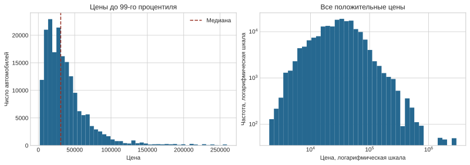
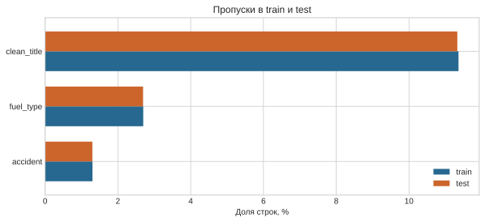
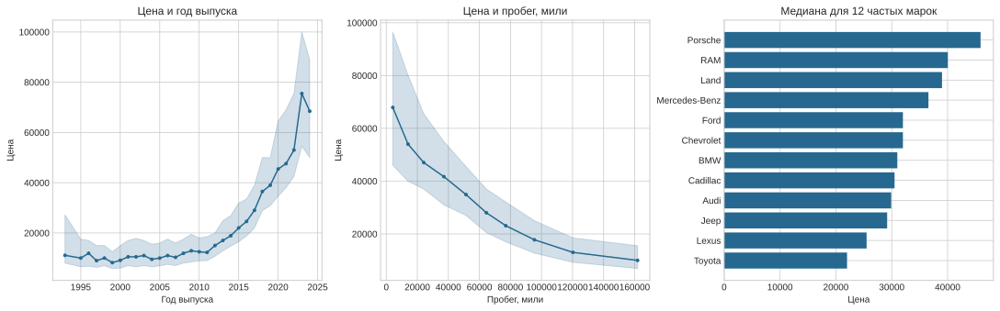
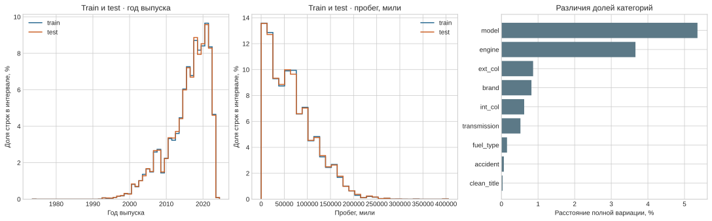

# Разведочный анализ цен автомобилей

Результаты получены на 188 533 обучающих и 125 690 тестовых строках соревнования. Источник данных синтетический. [Прогон EDA на Kaggle](https://www.kaggle.com/code/naum0v7/used-car-prices-eda) · [Числовая сводка](summary.json)

## Распределение цены

Медиана составляет 30 825, а среднее — 43 878. 99-й процентиль равен 259 500, максимальная цена — 2 954 083. Выше отметки 99 250, заданной правилом 1,5 межквартильного размаха, лежат 10 880 строк (5,77 % обучающей выборки). На кросс-валидации стоит сравнить обучение на исходной цене и на её логарифме, оценивая оба варианта по RMSE в исходных единицах. Самые крупные ошибки разберём отдельно.

## Пропуски и повторы

В обучающей выборке пропуски есть в `clean_title` (11,36 %), `fuel_type` (2,70 %) и `accident` (1,30 %). В тестовой выборке доли близки. У `clean_title` одно непустое значение в обеих выборках, поэтому полезный сигнал, если он есть, связан с самим наличием пропуска. Проверим это отдельным экспериментом. Полных совпадений по 11 признакам без `id` внутри выборок и между ними не обнаружено.

## Год, пробег и марка

Корреляция Спирмена цены с годом выпуска составляет +0,727, с пробегом −0,743. Год и пробег также связаны между собой (−0,738), поэтому вклад возрастных признаков будем оценивать сравнением моделей на одинаковых фолдах. Медианные цены по маркам различаются. Медиана по паре «марка и модель», рассчитанная на обучающей части каждого фолда, станет одним из бейзлайнов.

## Различия между train и test

Наибольшие расхождения в долях категорий наблюдаются у `model` и `engine`. Их расстояние полной вариации составляет 5,35 % и 3,66 % соответственно. Доля незнакомых значений мала, но они встречаются. Для кодирования категорий предусмотрим обработку таких значений.

