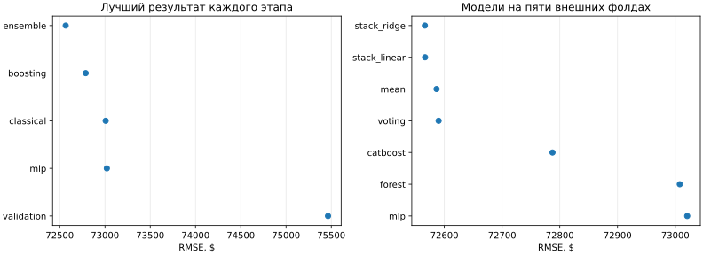
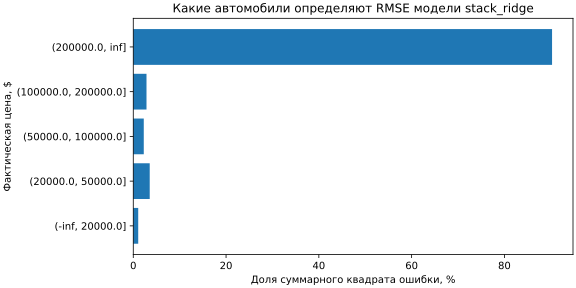

# Ансамбли для прогноза цены автомобиля

## Как устроена проверка

У каждого из 188 533 автомобилей есть один внешний проверочный прогноз каждого метода. Распределение по пяти фолдам совпадает с этапом 3. Итоговый RMSE вычислен по всем строкам в долларах.

В ансамбль вошли три конфигурации из предыдущих экспериментов. CatBoost использует исходные и дополнительные признаки с профилем `slower`. Случайный лес использует порядковое кодирование категорий, MLP обучается 12 эпох с функцией потерь Huber.

| Метод | Как получается цена |
|---|---|
| Среднее | Каждый из трёх прогнозов получает вес ⅓. |
| Взвешенное голосование | Веса заданы до сравнения ансамблей. CatBoost получает ½ как лучшая одиночная модель предыдущих этапов, лес и MLP получают по ¼. |
| Линейный стекинг | Линейная регрессия обучает свободный член и три коэффициента по внутренним отложенным прогнозам. |
| Стекинг Ridge | Входные прогнозы стандартизируются по внутренней обучающей выборке. Штраф Ridge равен 0,01 для среднего квадрата ошибки. В реализации sklearn это соответствует `alpha = 0.01 × число строк`. |

Для каждого внешнего фолда оставшиеся четыре фолда делятся заново на три части со стратификацией по цене. Каждая строка этой выборки получает прогнозы трёх базовых моделей из обучения на двух других частях. По этим прогнозам и известным ценам обучаются метамодели. Затем базовые модели переобучаются на всей внешней обучающей выборке и дают вход для проверки стекинга на пятом фолде. Предобработка каждый раз подбирается по соответствующей обучающей части.

Базовые конфигурации отобраны на предыдущих этапах по тем же пяти внешним фолдам. Метрика характеризует выбор решения на кросс-валидации. Отдельную оценку на скрытых ценах даст отправка в соревнование.

## Результаты и выбор модели

| Модель | RMSE, $ ↓ | MAE, $ ↓ |
|---|---:|---:|
| Стекинг Ridge | **72 566,31** | 19 318,86 |
| Линейный стекинг | 72 566,64 | 19 324,06 |
| Простое среднее | 72 586,53 | **18 832,02** |
| Взвешенное голосование | 72 590,09 | 18 904,14 |
| CatBoost | 72 787,32 | 19 399,09 |
| Случайный лес | 73 007,79 | 19 608,57 |
| MLP с Huber | 73 020,67 | 19 004,85 |

Для финальной отправки выбран стекинг Ridge по метрике соревнования. Снижение RMSE относительно CatBoost составило 221,01 (0,30 %). Между двумя вариантами стекинга всего 0,33. Ridge выиграл на первом и четвёртом фолдах, линейный стекинг на третьем и пятом, простое среднее на втором. У простого среднего также минимальная средняя абсолютная ошибка по всем строкам.

## Где возникают большие ошибки

Из 188 533 автомобилей 3 232 (1,71 %) стоят дороже 200 000 долларов. На эту группу приходится 90,27 % суммы квадратов ошибок Ridge. Модель в среднем занижает их цену на 301 165 долларов. В диапазоне от 20 000 до 50 000 долларов направление обратное — прогноз в среднем выше фактической цены на 10 548 долларов. Разбиение по фактической цене используется только при разборе уже полученных прогнозов.

При пробеге до 30 000 миль включительно средняя абсолютная ошибка составляет 37 396 долларов, при пробеге свыше 100 000 и до 200 000 миль — 6 511 долларов. У автомобилей 2005 года выпуска и старше самый высокий RMSE среди возрастных групп (113 565 долларов), а самая высокая MAE у машин после 2020 года (33 580 долларов). Эти группы могут отличаться также по цене и составу автомобилей.

## Файлы

| Файл | Содержимое |
|---|---|
| [ensemble.csv](ensemble.csv) | Общие RMSE, MAE и среднее отклонение прогноза от цены для семи методов. |
| [rmse_by_fold.csv](rmse_by_fold.csv) | Те же показатели по каждому внешнему фолду. |
| [all_models.csv](all_models.csv) | Все конфигурации этапов 3–7, упорядоченные по общему RMSE. |
| [errors_by_group.csv](errors_by_group.csv) | Ошибки выбранной модели по фактической цене, пробегу и году выпуска. |

Построчные прогнозы семи методов, идентификаторы, фактические цены и номера фолдов сохранены в `results/ensemble/oof.csv.gz`. [Выходные файлы запуска Kaggle](https://www.kaggle.com/code/naum0v7/used-car-prices-ensembles/output)
