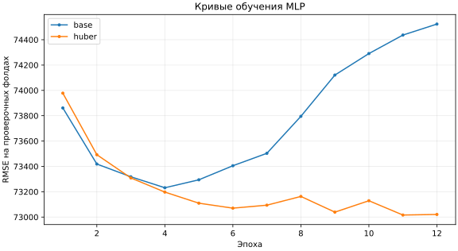

# Полносвязная нейросеть для оценки цены

Все конфигурации проверяются на пяти фолдах этапа 3. На вход подаются 11 исходных признаков. Числа стандартизируются по обучающему фолду, пропуски заполняются его медианами. Для категорий словарь строится на обучающем фолде. Неизвестные значения получают нулевой вектор. Эмбеддинги обучаются вместе с полносвязными слоями.

Базовая архитектура содержит скрытый слой на 128 нейронов с ReLU и выходной слой на одно число. Базовое обучение использует Adam, MSE, шаг 0,003, пакет 2 048 и 12 эпох. Для вычислений цену делим на 100 000, а RMSE приводим к исходной шкале. В опыте с Huber порог равен 100 000 в исходной шкале.

Каждая конфигурация меняет одну настройку базового варианта. Для сравнения используется RMSE после заранее заданного числа эпох. Итоговый показатель рассчитан по всем 188 533 проверочным прогнозам. Кривые показывают RMSE после каждой эпохи. Лучшая конфигурация выбрана по тем же фолдам, поэтому её результат следует интерпретировать как результат подбора на кросс-валидации.

## Результаты

В очереди Tesla T4 запуск задержался. Полный прогон завершился в версии № 2 на CPU в Kaggle с PyTorch 2.11.0. Время в таблице включает обучение и проверку после каждой эпохи и суммируется по пяти фолдам.

| Изменение относительно базы | RMSE ↓ | Время, с |
|---|---:|---:|
| Huber вместо MSE | **73 020,67** | 36,1 |
| Шаг обучения 0,001 | 73 411,69 | 36,3 |
| Косинусное расписание шага | 73 564,86 | 36,4 |
| Dropout 0,25 | 73 825,64 | 58,0 |
| BatchNorm | 73 969,35 | 40,0 |
| Dropout 0,10 | 74 116,67 | 52,6 |
| GELU вместо ReLU | 74 431,76 | 39,6 |
| SGD с momentum 0,9 | 74 437,87 | 32,6 |
| AdamW | 74 457,96 | 36,5 |
| Базовая конфигурация | 74 523,64 | 36,3 |
| Скрытый слой на 256 нейронов | 75 098,70 | 47,2 |
| Пакет 1 024 | 75 534,80 | 47,0 |
| Скрытые слои 128, 64 и 32 | 76 429,54 | 44,8 |
| 20 эпох | 77 209,00 | 60,5 |

Huber снизил RMSE на 1 502,98 (2,02 %) относительно базовой MLP. Меньший шаг обучения, косинусное расписание, Dropout и BatchNorm также снизили ошибку в отдельных опытах. Более глубокая и широкая сети, меньший пакет и 20 эпох дали большую ошибку. Эффекты измерены по одному изменению за раз.

Лучшая MLP уступила Random Forest на 12,88 и CatBoost на 233,35. Для сравнения использованы общие фолды. Вход MLP включал исходные признаки, а лучший CatBoost использовал дополнительные группы признаков.

[Итоги](mlp.csv) · [Ошибки по фолдам](rmse_by_fold.csv) · [Метрики по эпохам](curves.csv) · [Настройки моделей](settings.json) · [Прогон на Kaggle](https://www.kaggle.com/code/naum0v7/used-car-prices-mlp)
